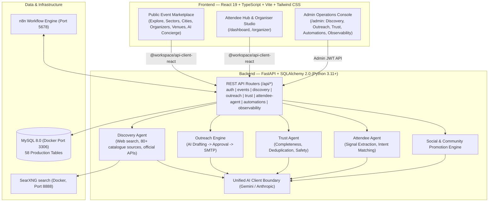

# 100 TIMES — Autonomous Event Discovery, Trust & AI-Driven Growth Platform

**100 TIMES** is an enterprise-grade, full-stack event discovery marketplace, attendee networking ecosystem, and autonomous AI-driven growth platform. It pairs a modern global event marketplace (Conferences, Expos, Summits, Workshops, Organizers, Venues, Speakers, Cities, and Sectors) with an integrated suite of **Autonomous AI Agents** orchestrated via **LangGraph**, **Google Gemini**, **Anthropic Claude**, and **FastAPI** for continuous event discovery, organizer outreach, trust scoring, and multi-channel promotion.

---

## Key Pillars & Autonomous Agent Ecosystem

### 1. Global Event Discovery Marketplace & Desk
* **Rich Multi-Dimensional Discovery:** Filter and search global events by sector, city, format (`In-Person`, `Virtual`, `Hybrid`), date range, and popularity.
* **Comprehensive Directories:** Dedicated profile and detail pages for **Events**, **Organizers**, **Venues**, **Speakers**, **Cities**, and **Sectors**.
* **Role-Based Workspaces & Unified Auth:**
  * **Attendee Hub:** Track digital passes, saved events, reviews, networking, and personalized AI recommendations.
  * **Organiser Studio (`/organizer`):** 25+ field event builder, automated Trust Agent verification, registration analytics, and attendee communication. Organisers can give every event a picture — upload their own (JPG/PNG/WebP, up to 5 MB) or pick one of 5 ready-made pictures for the event's sector (see [Event Pictures](#event-pictures)).
  * **Admin Operations Console (`/admin`):** Central command center for governing AI discovery agents, outreach approval queues, trust reviews, automations, and system telemetry.
* **Friendly Authentication UX:** Seamless account creation with sanitized error handling (no raw technical `401 Unauthorized` errors exposed to users, clear "No account details found" guidance with instant one-click registration).

### 2. Discovery Agent — Autonomous Event & Organizer Research
Finds upcoming events for the countries, cities and sectors an admin selects, and verifies each event's organiser — by fixed rules on the pages' own data, never invented details. A run is a concurrent six-stage pipeline (`orchestrator.py`) that stops as soon as the target number of **verified** events is reached:
1. **Plan:** search queries for every sector × place pair (`query_seeds.py`) and the selected sources (`catalog.py`).
2. **Collect:** web search through the configured providers — self-hosted **SearXNG** first (free), **Exa** as a paid top-up within a per-run budget, DuckDuckGo as last resort — plus direct reads of the source catalogue.
3. **Read pages (`page_extractor.py`):** schema.org event data first, then linked event pages, then a best-effort text reader whose results always go to review.
4. **Screen:** guardrails, sector match (a hard filter), country/city/state scope, past-date and duplicate checks (`validation.py`, `discovery_dedup.py`).
5. **Find organiser (`organizer_identifier.py`):** the organiser named on the event page or its official site, with a published contact e-mail; every field keeps the URL it came from.
6. **Decide & save (`storage.py`):** VERIFIED / NEEDS_REVIEW / REJECTED, with evidence URLs; rejected events can be kept for admin review.

**Source catalogue (`source_registry.py`, 80+ entries):** global event directories (IndustryEvents, ConferenceGrid, TradeShowBuzz, EventsEye, TradeFairDates, Expolya …), sector directories (Convene.md and Medical Events Now for medical conferences, OnSite and HackEvents for tech), exhibition organisers and venue calendars (Informa, RX, DMG Events, Messe Düsseldorf, Koelnmesse, DWTC, ExCeL …), associations and official APIs (IEEE vTools, Ticketmaster). Each catalogue entry is checked before it is added: robots.txt allows the page, and the platform's reader finds upcoming events on it. Sites that refuse automated access are not worked around. Each source's real health from runs and live checks is shown in the admin console.

**Admin pages:** run wizard (`/admin/discover`), automatic schedule (`/admin/discover/automatic`), sources & providers (`/admin/discover/configuration`), run history with per-source reports (`/admin/discover/runs`), and the event, organiser and contact lists under `/admin/discovery`.

### 3. Outreach Agent (Agent 2) — Contextual B2B Invitation Engine
Automates personalized invitations to event organizers with strict human-in-the-loop moderation:
* **Eligibility & Threshold Gating:** Enforces match thresholds and contact completeness before drafting emails.
* **Cryptographic Attribution Tracking:** Generates unique tracking URLs (`/api/attribution/click/{token}`) that attribute onboarding stages directly to outreach campaigns.
* **Human-in-the-Loop Moderation:** All generated invitations wait in **Pending Approval** in the Admin Console before dispatch via SMTP.
* **Automated Multi-Stage Follow-ups:** Automatically schedules follow-up drafts if an organizer hasn't responded within configured intervals.

### 4. Trust Agent — Event Verification & Safety Scoring
Evaluates every submitted event for safety, legitimacy, and completeness:
* **Duplicate Detection:** Calculates similarity scores against existing catalog listings and external discovered events.
* **Completeness & Scam Analysis:** Analyzes description quality, location feasibility, organizer credentials, and suspicious phrases.
* **Moderation Queue (`/admin/trust-review`):** High-confidence legitimate events publish instantly; borderline or flagged submissions enter an administrative review queue with one-click Approve, Reject, or Request Changes actions.

### 5. Attendee Agent — Intent Matching & Community Engagement
Listens to permitted community signals (Telegram, Discord, Reddit, RSS) to extract structured attendee interest:
* **Structured Intent Extraction:** Parses user queries into `category`, `location`, `time_range`, `event_type`, and `preferences`.
* **Weighted Relevance Scoring:** Matches user intent against live platform events to draft helpful, context-rich recommendations.
* **Registration Automation:** Coordinates capacity limits, waitlists, RFC 5545 `.ics` calendar sync, and multi-stage reminders (`T-7d`, `T-24h`, `T-1h`).

### 6. Social & Community Promotions
* **Multi-Platform Publishing:** Publishes promotional event briefs to Telegram channels/groups, Discord servers, LinkedIn, Instagram, Facebook, and X.
* **Configurable Cadence & Safety:** Platform-specific rate limiting, customizable targeting by sector, and automated toggle controls.

### 7. Automations & Observability Command Center
* **Unified Automations Dashboard (`/admin/automations`):** Real-time monitoring and toggles for Discovery, Outreach, Trust, and Social agents.
* **Observability & Telemetry (`/admin/observability`):** System health metrics, error rates, agent run history, and audit trails.
* **n8n Workflow Integration:** Eight production n8n workflows for event registration, confirmations, reminders, cancellations, and organizer retention.

---

## System Architecture



---

## Tech Stack

| Layer | Technologies |
| :--- | :--- |
| **Frontend** | React 19, TypeScript, Vite, Tailwind CSS, Wouter Router, TanStack React Query, Lucide Icons |
| **Backend API** | Python 3.11+, FastAPI, Uvicorn, Pydantic v2, SQLAlchemy 2.0, Alembic, PyJWT, passlib / bcrypt |
| **Database** | MySQL 8.0 (Docker container `100times-mysql` on port `3306`), PyMySQL |
| **AI Orchestration** | LangGraph, Google GenAI SDK, Anthropic Claude SDK |
| **Web Search** | Self-hosted SearXNG (free, `infra/searxng/`), Exa (optional paid top-up), DuckDuckGo fallback |
| **Automation** | n8n workflow engine (port 5678), in-process async schedulers |
| **Client Libraries** | `@workspace/api-client-react` (auto-generated typed React Query hooks and custom fetch) |

---

## Repository Structure

```text
100-Times-Event-Platform/
├── artifacts/
│   ├── 100-times/                        # React 19 + Vite Frontend
│   │   ├── public/event-images/          # Ready-made event pictures, 5 per sector (+ SOURCES.json)
│   │   ├── src/
│   │   │   ├── App.tsx                   # Main application router, Header, AuthPage & Marketplace
│   │   │   ├── ops/                      # Admin Operations Console:
│   │   │   │   ├── OpsLayout.tsx         # Admin navigation & search layout
│   │   │   │   ├── DashboardPage.tsx     # Operations overview & agent metrics
│   │   │   │   ├── RunWizardPage.tsx     # Step-by-step discovery run wizard
│   │   │   │   ├── AutomaticDiscoveryPage.tsx # Scheduled discovery settings
│   │   │   │   ├── DiscoveryConfigPage.tsx    # Sources, search providers & defaults
│   │   │   │   ├── RunReportPage.tsx     # Per-run report (stages, sources, outcomes)
│   │   │   │   ├── DiscoveryPage.tsx     # Discovered events & organizer leads
│   │   │   │   ├── OutreachPage.tsx      # Outreach campaigns & review queue
│   │   │   │   ├── TrustReviewPage.tsx   # Trust & safety verification queue
│   │   │   │   ├── AutomationsPage.tsx   # Live agent toggle controls & schedules
│   │   │   │   ├── ObservabilityPage.tsx # Telemetry, health & execution metrics
│   │   │   │   └── SettingsPage.tsx      # Target sectors, limits & API configurations
│   │   │   ├── organizer/                # Organiser Studio workspace (event wizard, EventPictureField)
│   │   │   ├── lib/eventImageLibrary.ts  # Sector → ready-made picture list
│   │   │   └── components/               # UI components (CountrySelect, ErrorBoundary, etc.)
│   │   └── package.json
│   └── api-server/                       # FastAPI Backend + Autonomous Agents
│       ├── backend/
│       │   ├── core/                     # Config, security, rate limiters, telemetry
│       │   ├── routes/                   # API routers (auth, events, discovery, outreach, media, etc.)
│       │   ├── services/
│       │   │   ├── discovery_agent/      # Agent 1: pipeline, source catalogue, site readers (adapters/), search providers
│       │   │   ├── social_agent/         # Outreach drafting, social connectors & promotion pipelines
│       │   │   ├── attendee_agent/       # Attendee signal parser & event recommendation
│       │   │   ├── community_agent/      # Community discovery & promotion
│       │   │   └── guardrails.py         # Content moderation & safety enforcement
│       │   ├── models.py                 # 58 SQLAlchemy ORM database models
│       │   ├── schemas.py                # Pydantic schemas & data contracts
│       │   └── main.py                   # FastAPI application entrypoint
│       ├── alembic/                      # Database migrations
│       ├── tests/                        # Comprehensive Pytest test suite
│       ├── uploads/                      # Organiser-uploaded event pictures (created at runtime, not in git)
│       └── .env.example                  # Environment configuration template
├── infra/searxng/                        # SearXNG settings for the Discovery Agent's web search
├── lib/
│   ├── api-client-react/                 # Generated React Query hooks & customFetch
│   └── api-spec/                         # OpenAPI specification
├── n8n/workflows/                        # 8 production n8n automation workflows
├── docker-compose.yml                    # Docker Compose stack
├── start_dev.py                          # Unified development launcher script
└── README.md                             # Platform documentation
```

---

## Local Development & Quickstart

### Prerequisites
* **Python 3.11+**
* **Node.js 20+** and **pnpm** (`npm install -g pnpm`)
* **Docker Desktop** (running)

### 1. Database Setup (MySQL 8.0 Container)
Start the MySQL 8.0 Docker container:
```bash
docker run -d --name 100times-mysql -p 3306:3306 -e MYSQL_ROOT_PASSWORD=<choose-a-strong-password> -e MYSQL_DATABASE=100times mysql:8.0
```

Start the self-hosted SearXNG search engine the Discovery Agent uses (free, no API key):
```bash
docker compose up -d searxng
```
Then set `SEARXNG_URL=http://127.0.0.1:8888` in the backend `.env`. Paid providers are optional: `EXA_API_KEY` enables Exa as a top-up when SearXNG returns too few results (capped per run by `PAID_SEARCH_CALLS_PER_RUN`).

### 2. Configure Backend Environment
Copy the backend `.env.example` file:
```bash
cp artifacts/api-server/.env.example artifacts/api-server/.env
```
Ensure `DATABASE_URL` is configured:
```env
DATABASE_URL=mysql+pymysql://root:<your-mysql-password>@127.0.0.1:3306/100times?charset=utf8mb4
```

### 3. Install Dependencies
**Backend:**
```bash
cd artifacts/api-server
python -m pip install -r requirements.txt
cd ../..
```

**Frontend:**
```bash
pnpm install
```

### 4. Launch Services
**Start FastAPI Backend:**
```bash
cd artifacts/api-server
python -m uvicorn backend.main:app --host 127.0.0.1 --port 8000
```

**Start Vite Frontend:**
```bash
cd artifacts/100-times
npx vite --host 0.0.0.0 --port 5174
```

* **Frontend Marketplace & Admin:** [http://localhost:5174](http://localhost:5174)
* **Backend API Documentation:** [http://127.0.0.1:8000/docs](http://127.0.0.1:8000/docs)

---

## Viewing the Database

### Option A: VS Code Database Client Extension
1. Open the **Database** panel in your VS Code sidebar.
2. Click **Create Connection** / **`+`** ➔ select **MySQL**.
3. Enter connection settings:
   * **Host:** `127.0.0.1`
   * **Port:** `3306`
   * **Username:** `root`
   * **Password:** your MySQL root password (keep it in `.env`, never in this file)
   * **Database:** `100times`
4. Expand `100times` ➔ `TABLE` to view all 58 tables and interact with live records.

### Option B: Terminal CLI via Docker
Connect directly to the interactive MySQL shell:
```bash
docker exec -it 100times-mysql mysql -u root -p 100times
```
Run queries:
```sql
SHOW TABLES;
SELECT id, name, email, role, created_at FROM users;
SELECT id, name, city, start_date, lifecycle_state FROM events;
```

---

## Event Pictures

When creating an event in the Organiser Studio (`/organizer/events/create`), the **Event Picture** section offers:
* **Upload your picture** — JPG, PNG or WebP up to 5 MB. `POST /api/organizer/event-images` (organisers and admins) checks the file really is that image type, stores it under a random name in `artifacts/api-server/uploads/event-images/`, and the event links to it at `/api/media/event-images/<name>`.
* **Choose a ready-made picture** — 5 pictures per sector (14 sectors, 70 pictures) in `artifacts/100-times/public/event-images/<sector>/`. They are free Unsplash photos (Unsplash License: commercial use allowed, no attribution required); `SOURCES.json` lists each original. A sector without its own set uses the general (`other`) pictures.

The picture is optional; an event without one keeps the platform's default image.

---

## Running Automated Tests

Run the complete backend test suite (700+ tests; they never touch the real database or send real e-mail):
```bash
cd artifacts/api-server
pytest
```

Type-check the frontend:
```bash
cd artifacts/100-times
npx tsc --noEmit -p .
```

---

## Security & Privacy Policy
* All sensitive credentials, tokens, and database credentials are excluded from version control via strict `.gitignore` rules.
* Human approval gates are enforced for all external email campaigns and borderline trust decisions.
* Built-in SSRF protection, rate limiting, and input sanitization protect all public and administrative endpoints.
