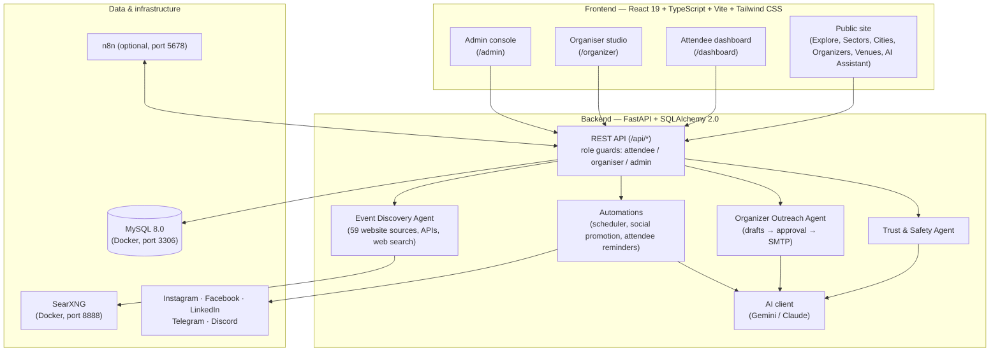

# 100 TIMES — Business Event Discovery & Growth Platform

**100 TIMES** is a full-stack platform for business events: conferences, trade fairs, expos and summits. People find and register for events, organisers publish and promote them, and three software agents do the slow research work: finding upcoming events across the web, checking every submitted event for safety, and drafting invitations to organisers.

Everything an agent produces is evidence-based (every saved fact keeps the URL it came from) and anything that contacts the outside world waits for a person, unless an admin deliberately switches on automatic publishing.

---

## Contents

1. [What the platform does](#what-the-platform-does)
2. [Accounts and roles](#accounts-and-roles)
3. [The three agents](#the-three-agents)
4. [Automations](#automations)
5. [Sectors](#sectors)
6. [Event sources](#event-sources)
7. [AI models, web search and costs](#ai-models-web-search-and-costs)
8. [Architecture](#architecture)
9. [Tech stack](#tech-stack)
10. [Repository structure](#repository-structure)
11. [Getting started](#getting-started)
12. [Configuration reference](#configuration-reference)
13. [Database](#database)
14. [Admin console map](#admin-console-map)
15. [Testing](#testing)
16. [Rules the code follows](#rules-the-code-follows)
17. [Known limitations](#known-limitations)

---

## What the platform does

| For | What they can do | Where |
|---|---|---|
| **Visitors** | Browse and search events by sector, country, city, format (in person / online / hybrid) and date (today, this weekend, next 7 days, this month, next 3 months or a custom range); browse sectors, cities, organisers and venues; ask the AI Assistant in plain language ("Find healthcare exhibitions in the USA"). | `/`, `/events`, `/categories`, `/cities`, `/organizers`, `/venues` |
| **Attendees** | Everything visitors can, plus: register for events, save events, keep a profile (personal details, interests, industries, countries), get recommendations and reminders, manage registrations and notifications. | `/dashboard/*` |
| **Organisers** | Publish events with a step-by-step form, write the description with the "Write it for me" assistant, add a picture (upload or pick a ready-made one for the sector), see registrations and analytics. Every submitted event goes through the Trust Agent. | `/organizer/*` |
| **Admins** | Run and schedule event discovery, review discovered events and organiser contacts, approve outreach e-mails, decide borderline Trust reviews, manage social promotion and automations, watch system health, AI usage and costs. | `/admin/*` |

---

## Accounts and roles

Attendee and organiser accounts are completely separate.

- **Sign-up** asks for the account type. An attendee account has role `USER`; an organiser account has role `ORGANIZER` (a company name is required). Roles are never upgraded automatically.
- **Access is enforced on the server**, not just hidden in the interface:
  - attendee APIs (`/api/attendee/*`, saved events, registrations, networking) use `require_attendee`;
  - organiser APIs (`/api/organizer/*`) use `require_organiser`;
  - admin APIs require `ADMIN` (admins can use everything).
- **The interface follows the role:** attendees never see "List an event"; organisers never see attendee tools and can't register for events; typing another area's URL shows a "this area is for … accounts" page. After login each role lands on its own home (`/dashboard`, `/organizer` or `/admin`).
- **Attendee data** lives in its own `attendee_profiles` table (migration `0015`).
- **The header** shows one profile button; all account options (dashboard, profile, List an event, admin pages, sign out) are in its drop-down menu.

---

## The three agents

### 1. Event Discovery Agent

Finds upcoming events for the countries, cities and sectors an admin selects, and the organiser behind each one. It uses fixed rules on the pages' own data (no AI model writes or guesses event details). A run is a concurrent six-stage pipeline (`backend/services/discovery_agent/orchestrator.py`) that stops as soon as the target number of **verified** events is reached:

1. **Plan:** one search query per selected sector × place (`query_seeds.py`), plus the selected sources (`catalog.py`).
2. **Collect:** web search through the configured providers and direct reads of the source catalogue (site readers in `adapters/`).
3. **Read pages:** schema.org event data first, then linked event pages, then a best-effort text reader whose results always go to review (`page_extractor.py`, `text_extractor.py`).
4. **Screen:** guardrails, sector match, country / city / state scope, past dates and duplicates (`validation.py`, `discovery_dedup.py`, `categorizer.py`).
5. **Find organiser:** the organiser named on the event page or its official site, with a published contact e-mail; listing sites', venues' and placeholder mailboxes are rejected; every field keeps the URL it was read from (`organizer_identifier.py`).
6. **Decide and save:** `VERIFIED`, `NEEDS_REVIEW` or `REJECTED`, with evidence URLs (`storage.py`).

Every run saves a full report (per stage, per source, per search provider) plus its **usage and estimated cost**, viewable under *Run history & reports*.

### 2. Trust & Safety Agent

Checks every event an organiser submits (`backend/services/trust_agent/`): completeness, duplicates against existing and discovered events, scam and spam language, prohibited content. It scores the event and publishes in two steps (approve, then publish). Confident results publish or reject automatically; uncertain ones wait in the **Trust review** queue (`/admin/trust-review`) for a person.

### 3. Organizer Outreach Agent

Drafts personal invitation e-mails to the organisers the Discovery Agent found, asking them to list their events on 100 TIMES, and drafts follow-ups when there's no reply (`backend/services/social_agent/outreach/`). **It never sends on its own:** every draft waits in *Pending* until a person approves and sends it over SMTP. Invitation links carry attribution tokens so sign-ups can be traced back to the campaign.

---

## Automations

Automations are switched on and off on `/admin/automations`. **All of them start switched off.**

| Automation | Trigger | What it does |
|---|---|---|
| **Automatic discovery** | On a schedule (default hourly), when on | Runs the Discovery Agent with the saved configuration. |
| **Outreach drafting & follow-ups** | On a schedule, when on | Drafts invitations and follow-ups. Drafts only; sending is always manual. |
| **Trust check** | Instantly, on every submission | Always on; runs the Trust & Safety Agent. |
| **Social promotion** | Instantly, when an event is published (from any path, including the admin Events page) | Writes a post per enabled platform (Instagram, Facebook, LinkedIn, Telegram, Discord) with UTM tracking. A post goes live automatically only on platforms with **auto-publish** on and **practice mode (dry run)** off; otherwise it waits for approval. Published Instagram links use the post's real permalink. Managed on `/admin/social-promotions`. |
| **Attendee reminders** | Every hour, when on | Reminders before an attendee's events, deadline alerts, change notices and new-match digests, only for attendees who opted in, each notice at most once. |

The in-process scheduler is `backend/services/social_agent/scheduler.py`; each loop checks its own live switch, so turning one on or off needs no restart. Optional n8n workflows (`infra/n8n/workflows/`, `n8n/workflows/`) cover registration e-mails, reminders and other event-lifecycle messages.

---

## Sectors

The platform lists events in **12 business sectors** (plus "Other"):

Construction · Energy and Power Generation · Finance · Healthcare · Manufacturing · Mining · Oil and Gas · Packaging · Pharmaceuticals · Telecommunications · Textiles · Transport and Logistics

**Technology is not a 100 TIMES sector.** Its category row is kept in the database but hidden everywhere (`backend/services/sectors.py`): it's not offered on the site or in the organiser form, `/api/categories/technology` returns 404, and discovery still *recognises* technology events so it can reject them, instead of misfiling them under another sector.

---

## Event sources

The source catalogue (`backend/services/discovery_agent/source_registry.py`) has **59 event websites** the Event Finder reads directly, plus official APIs and search tools. Each entry records the sectors and countries it covers, how it's read (event pages, structured event data, official API, calendar feed) and its live health from real runs.

| Kind | Examples |
|---|---|
| Global event directories | IndustryEvents, ConferenceGrid, TradeShowBuzz, EventsEye, TradeFairDates, Expolya, Conference Alerts, Clocate, Trade Show Radar, Tradefest |
| Sector directories | Medical Events Now, Convene.md (medical), The Expo Co and Pilars (construction) |
| Exhibition organisers | Informa Markets, RX Global, dmg events, Terrapinn, Messe Düsseldorf, Messe Frankfurt, NürnbergMesse, Tarsus, Clarion |
| Venue calendars | India Expo Centre & Mart, Dubai World Trade Centre, ExCeL London, Javits Center, McCormick Place, Singapore EXPO |
| Associations and official APIs | IEEE (vTools API), ASME, ASCE, ASCO, GTR Events, Ticketmaster Discovery API |

**Rules for every source:** it's added only after checking that robots.txt allows the page and the reader finds upcoming events on it; sites that block automated visitors are not worked around (no stealth, no proxies, no headless retries after a 403). Sources whose events don't fall in the 12 sectors were removed.

---

## AI models, web search and costs

### AI models

All AI calls go through one client, `backend/services/social_agent/ai_client.py`, which supports **Google Gemini** and **Anthropic Claude** with the same four operations (structured answer, text, web-search-grounded answer, connectivity ping). Switch with `AI_PROVIDER=gemini|anthropic` and `GEMINI_MODEL` / `ANTHROPIC_MODEL`. The client never invents a fallback answer: a missing key or failed call raises `AIClientError`, and callers fall back to their fixed templates.

| Feature | Uses AI for |
|---|---|
| Trust & Safety Agent | A structured safety assessment (`trust_assessment`) |
| Outreach Agent | Writing invitations and follow-ups (`write_outreach_email`) |
| Social promotion | Writing each platform's post (`generate_social_promotion_post`) |
| Website AI Assistant | Turning a question into search filters (`event_search_filters`) |
| Organiser "Write it for me" | Writing an event description from the form's facts only |
| Event Discovery Agent | No AI model. Only the "Google via Gemini" search provider calls Gemini (Google Search grounding). |

### Web search providers

Self-hosted **SearXNG** (free) is asked first; paid providers top up one at a time, cheapest first, only while results are short and within `PAID_SEARCH_CALLS_PER_RUN`: **Exa**, **Google via Gemini grounding**, **Google Custom Search**, **Brave**. DuckDuckGo is the last resort. (Bing's API was retired by Microsoft in August 2025.)

### Usage and cost tracking

Every discovery run stores its own usage in `agent_runs.summary["usage"]` (`backend/services/discovery_agent/run_usage.py`), shown on **System health → AI Usage & Cost**:

- **Search queries** (attempted, with results, from cache, no results, not sent) and **provider requests** (attempted, succeeded, failed, rate-limited), counted so retries, cache hits and parallel calls aren't double-counted.
- **AI model calls and tokens** exactly as each model API reports them.
- **Cost:** a provider's own reported cost first (Exa reports it); otherwise a configured price (`SEARCH_PRICING_USD_PER_1000`, `AI_MODEL_PRICING_USD_PER_MTOK`); otherwise **Unknown**. A provider is never assumed free just because it doesn't report a cost; only self-hosted SearXNG and the DuckDuckGo fallback have no per-search fee. Failed requests cost $0.
- A **latest run** summary and a **per-run history** table, re-priced from stored counts whenever prices change.

---

## Architecture



---

## Tech stack

| Layer | Technologies |
|---|---|
| Frontend | React 19, TypeScript, Vite 7, Tailwind CSS 4, Wouter router, TanStack React Query, Radix UI, Lucide icons |
| Backend | Python 3.11+ (developed on 3.14), FastAPI, Uvicorn, Pydantic v2 + pydantic-settings, SQLAlchemy 2.0, Alembic, PyJWT, passlib/bcrypt |
| Database | MySQL 8.0 in Docker (`100times-mysql`), PyMySQL |
| AI | Google GenAI SDK (Gemini), Anthropic SDK (Claude), LangGraph (workflow pipeline only) |
| Web reading | requests/httpx, BeautifulSoup, Playwright (optional browser rendering for script-built pages) |
| Web search | SearXNG (self-hosted), Exa, Gemini grounding, Google Custom Search, Brave, DuckDuckGo fallback |
| Workspace | pnpm workspace; `lib/api-client-react` (generated React Query hooks) and `lib/api-spec` (OpenAPI) |
| Automation | In-process asyncio scheduler; optional n8n |

---

## Repository structure

```text
├── artifacts/
│   ├── 100-times/                       # React frontend
│   │   ├── public/event-images/         # Ready-made event pictures, 5 per sector (+ SOURCES.json)
│   │   └── src/
│   │       ├── App.tsx                  # Router, header + account menu, public pages, auth, role gates
│   │       ├── lib/account.ts           # Account type, home path per role, which areas a role may open
│   │       ├── attendee/                # Attendee dashboard: Discover, Profile, API hooks
│   │       ├── organizer/               # Organiser studio, picture field, description assistant
│   │       └── ops/                     # Admin console (run wizard, reports, outreach, trust review,
│   │                                    #   automations, social promotion, observability, settings …)
│   └── api-server/                      # FastAPI backend
│       ├── backend/
│       │   ├── main.py                  # App entry point, routers, background scheduler
│       │   ├── core/                    # Settings (config.py), security, rate limiter
│       │   ├── models.py                # SQLAlchemy models (64 tables)
│       │   ├── schemas.py               # Pydantic request/response models
│       │   ├── dependencies.py          # Auth + role guards (require_attendee, require_organiser …)
│       │   ├── routes/                  # API routers
│       │   └── services/
│       │       ├── discovery_agent/     # Pipeline, source registry, site readers, search providers, usage
│       │       ├── trust_agent/         # Trust & Safety Agent
│       │       ├── social_agent/        # AI client, outreach agent, publishers, social promotion, scheduler
│       │       ├── attendee_agent/      # Catalog, matching, AI Assistant, reminders, attendee profile
│       │       ├── sectors.py           # Removed sectors (Technology)
│       │       └── event_writer.py      # Organiser description assistant
│       ├── alembic/versions/            # Database migrations (0001–0015)
│       ├── tests/                       # Pytest suite (60 files, 700+ tests)
│       ├── requirements.txt
│       └── .env.example                 # Every setting, with comments (no real values)
├── infra/
│   ├── searxng/                         # SearXNG settings for discovery web search
│   └── n8n/workflows/                   # n8n workflows (discovery, outreach follow-up, publishing …)
├── n8n/workflows/                       # n8n event-lifecycle workflows (registration, reminders …)
├── lib/                                 # Shared frontend packages (API client, OpenAPI spec)
├── docker-compose.yml                   # SearXNG, n8n, (optional) Postgres and API services
├── start_dev.py                         # Starts backend (8000) and frontend (5174) together
└── pnpm-workspace.yaml
```

---

## Getting started

### Prerequisites

- **Python 3.11+**
- **Node.js 20+** and **pnpm** (`npm install -g pnpm`)
- **Docker Desktop**, running

### 1. Start MySQL and SearXNG

```bash
docker run -d --name 100times-mysql -p 3306:3306 \
  -v 100times_data:/var/lib/mysql \
  -e MYSQL_ROOT_PASSWORD=<choose-a-strong-password> -e MYSQL_DATABASE=100times mysql:8.0

docker compose up -d searxng
```

The named volume (`100times_data`) keeps the data if the container is removed.

### 2. Configure the backend

```bash
cp artifacts/api-server/.env.example artifacts/api-server/.env
```

Set at least:

```env
DATABASE_URL=mysql+pymysql://root:<your-mysql-password>@127.0.0.1:3306/100times?charset=utf8mb4
JWT_SECRET=<a long random string>
SEARXNG_URL=http://127.0.0.1:8888
```

Everything else is optional; see [Configuration reference](#configuration-reference). Settings are read from `.env` files in this order, the **last one found wins**: the current directory, `artifacts/api-server/`, `artifacts/`, the project root, and the folder above it. Check that no parent folder has an `.env` overriding the values you set.

### 3. Install dependencies

```bash
# Backend
cd artifacts/api-server
python -m venv backend/venv
backend/venv/Scripts/python -m pip install -r requirements.txt   # Windows
# source backend/venv/bin/activate && pip install -r requirements.txt   # macOS / Linux
python -m playwright install chromium   # optional: browser rendering for script-built pages
cd ../..

# Frontend
pnpm install
```

### 4. Create the database tables

In development the tables are created at startup (`AUTO_CREATE_SCHEMA=true`). For production run the migrations:

```bash
cd artifacts/api-server
alembic upgrade head
```

### 5. Run

```bash
python start_dev.py
```

or separately:

```bash
cd artifacts/api-server && python -m uvicorn backend.main:app --host 127.0.0.1 --port 8000
cd artifacts/100-times && npx vite --host 0.0.0.0 --port 5174
```

| What | Address |
|---|---|
| Website and admin console | http://localhost:5174 |
| API docs (Swagger) | http://127.0.0.1:8000/docs |
| Health check | http://127.0.0.1:8000/api/healthz |

The frontend proxies `/api` to the backend.

---

## Configuration reference

All settings live in `artifacts/api-server/.env` (template: `.env.example`). **Never commit `.env`**; it's in `.gitignore`.

| Group | Settings | Notes |
|---|---|---|
| App | `APP_NAME`, `ENVIRONMENT`, `APP_BASE_URL`, `PLATFORM_LISTING_URL`, `CORS_ORIGINS`, `AUTO_CREATE_SCHEMA`, `SEED_DEMO_DATA` | `PLATFORM_LISTING_URL` is the public site address used in promotion links and event pictures. |
| Database & auth | `DATABASE_URL`, `JWT_SECRET`, `JWT_ALGORITHM`, `ACCESS_TOKEN_EXPIRE_MINUTES` | |
| AI | `AI_PROVIDER`, `GEMINI_API_KEY`, `GEMINI_MODEL`, `ANTHROPIC_API_KEY`, `ANTHROPIC_MODEL` | `AI_PROVIDER` is `gemini` or `anthropic`. |
| Web search | `SEARXNG_URL`, `EXA_API_KEY`, `GOOGLE_SEARCH_API_KEY`, `GOOGLE_CSE_ID`, `BRAVE_SEARCH_API_KEY`, `SEARCH_STRATEGY`, `PAID_SEARCH_CALLS_PER_RUN` | `SEARCH_STRATEGY` = `free_first` (default) or `parallel`. |
| Cost prices | `SEARCH_PRICING_USD_PER_1000`, `AI_MODEL_PRICING_USD_PER_MTOK` | JSON; used only where a provider doesn't report its cost. |
| Discovery | `DISCOVERY_DAILY_LIMIT`, `DISCOVERY_CONFIDENCE_THRESHOLD`, `DISCOVERY_BROWSER_FETCH`, `DISCOVERY_EVENTS_PER_LISTING`, `TICKETMASTER_API_KEY` | |
| Trust Agent | `TRUST_AGENT_AUTO_APPROVE_SCORE`, `TRUST_AGENT_MIN_DESCRIPTION_LENGTH`, `TRUST_AGENT_MAX_DAILY_SUBMISSIONS_PER_ORGANIZER` | |
| Outreach & e-mail | `OUTREACH_MATCH_THRESHOLD`, `OUTREACH_DAILY_CAP`, `OUTREACH_FOLLOWUP_DAYS`, `ORGANIZER_FOLLOWUP_*`, `SMTP_HOST`, `SMTP_PORT`, `SMTP_USERNAME`, `SMTP_PASSWORD`, `SMTP_FROM_EMAIL`, `SMTP_USE_TLS` | Without SMTP, e-mails stay unsent and attendee notices are in-app only. |
| Social publishing | `INSTAGRAM_ACCESS_TOKEN`, `INSTAGRAM_BUSINESS_ACCOUNT_ID`, `FACEBOOK_PAGE_ACCESS_TOKEN`, `FACEBOOK_PAGE_ID`, `LINKEDIN_ACCESS_TOKEN`, `LINKEDIN_ORGANIZATION_ID`, `TELEGRAM_BOT_TOKEN`, `DISCORD_BOT_TOKEN`, `SOCIAL_AGENT_DAILY_CAP_PER_PLATFORM` | Telegram and Discord also need a channel set as the platform's destination on the Social promotion page. |
| n8n | `N8N_URL`, `N8N_ENCRYPTION_KEY`, `N8N_WEBHOOK_SECRET`, `N8N_WEBHOOKS_ENABLED` | Optional. |

---

## Database

- **MySQL 8.0**, database `100times`, 64 tables (`backend/models.py`). Migrations are in `alembic/versions/`.
- **Moving the database** to another machine: export with `mysqldump` inside the container, copy the file out, import it on the other side.

  ```bash
  docker exec 100times-mysql sh -c 'mysqldump -uroot -p"$MYSQL_ROOT_PASSWORD" --single-transaction --databases 100times > /tmp/100times.sql'
  docker cp 100times-mysql:/tmp/100times.sql ./100times.sql
  # on the other machine, after starting its container:
  docker cp ./100times.sql 100times-mysql:/tmp/100times.sql
  docker exec 100times-mysql sh -c 'mysql -uroot -p"$MYSQL_ROOT_PASSWORD" < /tmp/100times.sql'
  ```

  The export contains users' e-mails and password hashes: share it privately, never in git. On Windows PowerShell don't redirect `mysqldump` output with `>` (it re-encodes the file); use the two-step export above.
- **Starting fresh** works too: the backend creates the tables and loads the source catalogue on first start.

---

## Admin console map

| Section | Pages |
|---|---|
| Overview | Dashboard `/admin` |
| Discover events | Run discovery `/admin/discover`, Automatic discovery `/admin/discover/automatic`, Run history & reports `/admin/discover/runs` |
| Event management | New discoveries `/admin/discovery`, All events, Organizers, Contacts `/admin/discovery/*` |
| Discovery configuration | Sources, search providers and defaults `/admin/discover/configuration` |
| Organizer outreach | All / Pending / Sent / Delivered / Replies / Follow-ups `/admin/outreach/*` |
| Platform data | Overview, Events, Users, Organizers, Sectors, Venues, Reviews |
| Agents | Trust agent `/admin/trust-review` |
| Automations | All automations `/admin/automations`, Social promotion `/admin/social-promotions` |
| Administration | Providers & API keys `/admin/settings`, System health `/admin/observability` (incl. AI Usage & Cost), n8n workflows, Audit & system logs |

---

## Testing

```bash
# Backend: 700+ tests
cd artifacts/api-server
python -m pytest

# Frontend type check
cd artifacts/100-times
npx tsc --noEmit -p .
```

The test suite never touches the real database or sends real e-mail (guards in `tests/conftest.py`), and AI calls are replaced with a fake client.

---

## Rules the code follows

- **No invented data.** Every number, status, e-mail and timestamp shown in the admin console comes from the database; missing facts stay empty instead of being guessed. AI writers may only use facts they were given.
- **People approve outreach.** Outreach e-mails are always sent by a person; borderline Trust reviews are decided by a person; social posts go live automatically only on platforms an admin set to auto-publish.
- **Automations default off.**
- **Respect websites.** robots.txt is honoured and blocks are never worked around.
- **Secrets stay out of git.** API keys and passwords live only in `.env`; the app reports which settings are missing by name, never their values.
- **Built-in protection.** SSRF protection on outgoing requests, rate limiting, input validation and role checks on every protected endpoint.

---

## Known limitations

- **Instagram needs a public picture.** A post's picture must be downloadable from the internet, so Instagram posts for events with a locally stored picture only work once the site is hosted at `PLATFORM_LISTING_URL` (or `PUBLIC_BASE_URL`).
- **LinkedIn posting** needs `LINKEDIN_ACCESS_TOKEN`; **Telegram and Discord** need a destination channel.
- **Some sources have no sector pages.** Many exhibition organisers filter their calendars with on-page search, so there is no fixed per-sector link; discovery reads their full calendar and filters by sector itself.
- **Gemini Google Search grounding** has no free tier on Gemini 3 models; it needs a paid Gemini plan.
