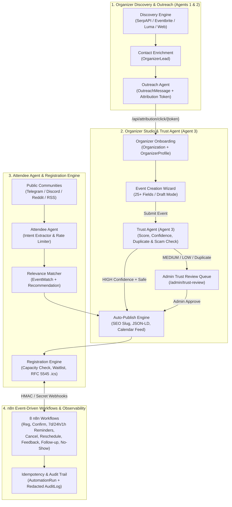
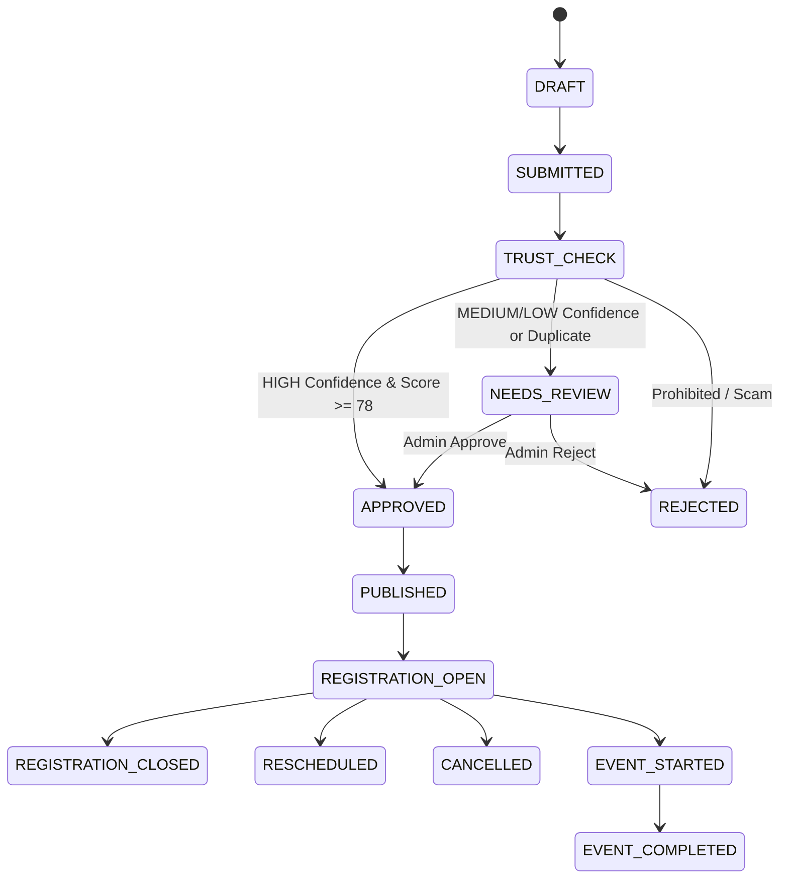

# System Architecture — 100 TIMES Event Platform

**Document Version:** 2.0  
**Repository Root:** `C:\BALAJI\100-Times-Event-Platform\100-Times-Event-Platform`

---

## 1. High-Level Architecture Diagram

---

## 2. Multi-Tier Technical Architecture

### 2.1 Frontend Layer (`artifacts/100-times`)
- **Framework:** React 19 + TypeScript + Vite (`port 5174`) + Tailwind CSS + Wouter Router + Lucide Icons.
- **Key Modules:**
  - `src/pages/Home.tsx` — Public event marketplace, category/city filters, event detail modal, and attendee registration modal.
  - `src/organizer/OrganizerStudio.tsx` — Organizer authentication, onboarding profile, 12-stage lifecycle tracker, and 7-step Event Creation & Trust Agent verification wizard.
  - `src/ops/TrustReviewPage.tsx` (`/admin/trust-review`) — Trust Agent moderation console with duplicate candidate diffs and audit trail.
  - `src/ops/AttendeeAgentPage.tsx` (`/admin/attendee-agent`) — Community source toggles, rate-limit gauges, live Intent Extractor, and match telemetry.
  - `src/ops/WorkflowsLogsPage.tsx` (`/admin/workflows` & `/admin/audit-logs`) — n8n workflow triggers, idempotent `AutomationRun` history, and redacted `AuditLog` explorer.

### 2.2 Backend API & Agent Layer (`artifacts/api-server/backend`)
- **Framework:** Python 3.11+ / FastAPI (`port 8000`) / SQLAlchemy 2.0 ORM / Pydantic v2.
- **Core Services:**
  - `services/discovery_agent/orchestrator.py` & `services/discovery_agent/validation.py` — Autonomous multi-source discovery across the 12 approved sectors, contact enrichment, and **Mandatory Contact Qualification Gate** (enforces that events must possess at least one organizer contact: email OR phone; events lacking both are disqualified).
  - `services/trust_agent/agent.py` — **Trust Agent (Agent 3)** (`evaluate_event_trust`, `admin_decide_trust_review`, contact completeness check).
  - `services/attendee_agent/agent.py` — **Attendee Agent** (`extract_attendee_intent`, `match_events_for_intent`, `process_attendee_signal`, `run_attendee_discovery_cycle`).
  - `services/registration_automation.py` — Registration state machine, overbooking guard, `zoneinfo.ZoneInfo` reminder scheduler (`T-7d`, `T-24h`, `T-1h`), cancellation, reschedule, attendance/no-show, and organizer multi-touch follow-up engine.
  - `services/community_agent/orchestrator.py` & `services/community_agent/query_seeds.py` — **Community Discovery Agent (Agent 5)**: Automated discovery of public Telegram channels/groups and Discord servers targeted strictly at the 12 approved platform sectors via two-stage ingestion (Stage 1 sector seed directories + Stage 2 round-robin query seeds) and strict category qualification gate (skipping non-approved domains/Other).
  - `services/social_agent/publishers/` — **Multi-Mode Social Publishers**:
    - **Bot Mode:** `DiscordPublisher` (Discord Bot REST API) & `TelegramPublisher` (Telegram Bot API).
    - **User Automation Mode:** `DiscordUserPublisher` (`publishers/discord_user.py` — hands-free user account posting into external joined servers via `DISCORD_USER_TOKEN` with human-like typing simulation and invite code auto-join) & `TelegramUserPublisher` (`publishers/telegram_user.py` — Telegram MTProto User Client via `Telethon` for auto-joining public groups and posting event updates on autopilot).
  - `services/notifications.py` — 16 notification templates + RFC 5545 `.ics` / Google Calendar / Outlook generator.
  - `services/lifecycle.py` — Event 13-state machine & Organizer 12-stage progression engine.
  - `services/audit.py` — Recursive secret-redacting audit logger (`record_audit_log`).

### 2.3 Persistence Layer (`models.py` & `db.py`)
- **Dual-Dialect Support:** PostgreSQL (production/local) and SQLite (isolated test suites) with automatic non-destructive column synchronization (`sync_schema_columns(engine)`).
- **30+ Domain Models:**
  - *Core & Discovery:* `User`, `Organizer`, `Organization`, `OrganizerProfile`, `DiscoveredEvent`, `DiscoveryQuery`, `OrganizerLead`, `OutreachMessage`, `AttributionRecord`, `PipelineRun`, `DiscoveredCommunity`, `CommunitySource`.
  - *Events & Locations:* `Event`, `EventLocation`, `Ticket`.
  - *Trust & Safety:* `TrustReview`, `TrustDecision`, `DuplicateCandidate`.
  - *Attendees & Automation:* `Registration`, `Attendee`, `AttendeeIntent`, `EventMatch`, `AgentMessage`, `EventReminder`, `OrganizerFollowup`, `AttendeeFeedback`, `Notification`, `AutomationRun`, `AuditLog`.

---

## 3. State Machines

### 3.1 Event Lifecycle State Machine

### 3.2 Organizer 12-Stage Lifecycle
`DISCOVERY` → `OUTREACH_SENT` → `CLICKED_LINK` → `ACCOUNT_CREATED` → `PROFILE_COMPLETED` → `EVENT_DRAFT_CREATED` → `EVENT_SUBMITTED` → `TRUST_APPROVED` → `EVENT_PUBLISHED` → `REGISTRATIONS_ACTIVE` → `EVENT_COMPLETED` → `REPEAT_ORGANIZER`
